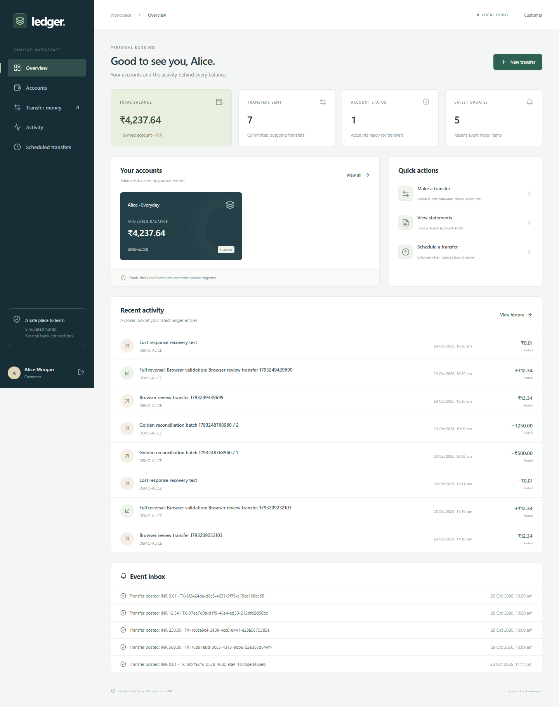
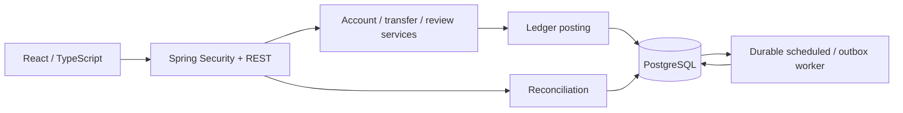

# Digital Banking Ledger & Transaction Reconciliation System

A local Java/React application for simulated internal transfers, double-entry bookkeeping, account history, statement reconciliation, reviewed full reversals, and audit evidence. It runs without a paid API or hosted service.



All identities, statements, and money are synthetic. This project does not connect to banks, UPI, card networks, or real payment services.

## Run locally on Windows

Prerequisites: JDK 21, Node.js 24, and native PostgreSQL 17 or 18. Set `JAVA_HOME` and optionally `PG_BIN` if installed outside the usual Windows locations. The scripts also detect an installed JDK 21 and PostgreSQL under Program Files. Initial dependency downloads need internet access.

Open PowerShell in this project folder:

```powershell
# First build: install frontend dependencies, run tests, and package the app.
.\scripts\database.ps1
.\scripts\build.ps1 -Install

# Start the packaged backend and included React interface.
.\scripts\start.ps1
```

Open **http://127.0.0.1:8080**. The first start seeds demo identities and opening balances. Subsequent starts preserve data and do not fund those accounts again.

The project uses its own PostgreSQL cluster under `.runtime/db`, bound to `127.0.0.1:55438`. It creates separate `ledger` and `ledger_test` databases. Existing system PostgreSQL clusters are not reused or changed.

| Identity | Email | Permission |
| --- | --- | --- |
| Alice | alice@ledger.local | Customer; opening balance INR 5,000 |
| Bob | bob@ledger.local | Customer; opening balance INR 1,000 |
| Operations | operator@ledger.local | Imports, investigations, account freezes, correction requests |
| Approver | approver@ledger.local | Approve/reject another person's correction |
| Auditor | auditor@ledger.local | Read staff evidence and protected metrics |

Demo password for all five: **`DemoBank!2026`**. The login screen can fill these local demo credentials. New registrations always create customers with no financial balance.

The native cluster defaults use `ledger_owner` / `local_owner_only` for migrations and `ledger_app` / `local_demo_only` for application queries. These are documented local demo credentials, not deployment secrets. Keep the service on localhost. `.env.example` documents runtime settings; copy it to `.env` if overrides are needed. Changing credentials for an existing database requires changing the database role too.

To stop this project's processes:

```powershell
.\scripts\stop.ps1
# Include the isolated database server when finished:
.\scripts\stop.ps1 -Database
```

Stop the backend before repackaging on Windows because the running JVM holds its JAR open.

## Review the application

1. Sign in as Alice. Open Accounts and copy `DEMO-ALICE` if needed.
2. Transfer an amount such as `25.00` to `DEMO-BOB`. Review and confirm it.
3. Open Activity, inspect the transfer, and download a statement.
4. Sign out and sign in as Bob. The matching credit appears in his account history.
5. As Operations, inspect Ledger explorer. Open the journal to see both entries.
6. Request a full reversal with a reason. Sign out and use Approver to decide it.
7. The original journal remains unchanged; a new reversing journal records the correction.
8. Open Reconciliation. Run an internal integrity check; a healthy dataset produces zero findings.
9. Run the optional demo scenario below to populate a clean statement and an intentionally mismatched statement. Inspect source rows, internal legs, and investigation history.
10. Review Audit trail and Background activity. Schedule a small customer transfer to see the durable worker process it.

Existing review data can include transfers, pending correction requests, reversals, and synthetic exceptions created by automated browser checks. Opening balances describe the initial seed, not a promise that the current database is untouched.

## Implemented behavior

- Exact INR amounts with `BigDecimal` / `NUMERIC(19,2)`; string amounts at the API boundary.
- Balanced double-entry journals checked by deferred PostgreSQL constraint triggers at actual commit.
- Database permissions and triggers preventing edits/deletions of posted journal and audit evidence.
- Atomic transfer, both balance projections, audit event, outbox event, and saved idempotency result.
- Database-enforced idempotency keys scoped to customer and operation, including concurrent requests and saved business rejections.
- Account row locks acquired in deterministic order; the same lock convention applies to freezing and reversals.
- Owned-account authorization, four fixed business roles, session cookies, CSRF protection, login throttling, and bounded inputs.
- CSV import evidence, duplicate-file detection, invalid-row evidence, immutable run snapshots, exact per-account-leg matching, and versioned reruns.
- Maker/approver separation for full reversals. Spent recipient funds and inactive accounts prevent posting.
- Shared PostgreSQL sessions, a transactional outbox, deduplicated inbox delivery, retries, failed-event inspection, and safe event requeue.
- Durable scheduled transfers with creation idempotency, cancellation, execution-time funds checks, and restart recovery.
- Responsive customer/staff UI, histories, statement downloads, audit search, operational health, and restricted metrics.

## Architecture and accounting



The backend is a modular monolith. Monetary posting remains in one database transaction. Two application instances can share that database without splitting the debit and credit across services.

From the bank's perspective, customer deposits are liabilities. Alice sending INR 500 to Bob debits Alice's deposit liability and credits Bob's. Customer balance is credits minus debits. Demo funding debits a simulated cash asset and credits the deposit liability. A reversal swaps the sides in a new journal.

The journal is the financial record; stored balances are transactionally maintained projections checked by reconciliation. Audit records describe the actor and reason. Notifications are a separate eventual consumer of committed events.

## Build and verification commands

```powershell
# Backend unit and real-PostgreSQL integration tests
.\backend\mvnw.cmd test

# Frontend tests and production build
Set-Location frontend
npm.cmd run test
npm.cmd run build
Set-Location ..

# Start the optional Vite development interface on port 5178
# (backend must be stopped before using start.ps1 again)
.\scripts\start.ps1 -DevUI

# Browser tests need the backend and development UI running.
Set-Location frontend
npm.cmd run test:e2e
Set-Location ..

# Separate temporary JVMs and a fresh isolated database
.\scripts\cluster-check.ps1

# Backup / isolated restore check; run with no concurrent financial writes
.\scripts\backup.ps1
.\scripts\restore-test.ps1
```

The Windows Maven launcher invokes Java directly so the ampersand in this folder's name is safe. It bootstraps Apache Maven 3.9.11 with checksum verification if absent and stores Maven dependencies under `.tools/m2`. This is a project-local launcher, not the standard Apache Maven Wrapper implementation.

Playwright uses installed Microsoft Edge. Its browser channel can be changed in `frontend/playwright.config.ts` if another compatible browser is installed. Headless test runs save screenshots and failure traces. Do not treat skipped or unexecuted checks as passing.

See [verification evidence](docs/VERIFICATION.md), [architecture decisions](docs/decisions/001-implementation-stack.md), [operations](docs/OPERATIONS.md), [API contract](docs/openapi.yaml), [review guide](docs/REVIEW_GUIDE.md), and the original [implementation blueprint](docs/IMPLEMENTATION_BLUEPRINT.md).

## Repository map

```text
backend/       Spring Boot, SQL migrations, financial/security/integration tests
frontend/      React application, component helpers, browser tests
scripts/       Windows setup/build/start/stop, two-instance checks, backup/restore
fixtures/      Synthetic statement explanations and reproducible demo generation
docs/          Blueprint, decisions, API contract, screenshots, verification
.runtime/      Ignored local databases, logs, backups, generated review files
.tools/        Ignored local build tools and dependency cache
```

## Scope limits

The implemented specialization is scheduled internal transfers. Multi-currency FX, pending-fund holds, interest, fees, loans, partial reversals, cross-database settlement, brokers, Kubernetes, real identity verification, external payments, and public hosting are outside this release.

The two-instance check is a local correctness and recovery demonstration, not a high-availability or production capacity certification. Append-only controls do not protect against a database owner or machine administrator. The current native database version is reported in the verification document; no system-wide database installation was upgraded.

The supplied scripts target Windows. Docker, cloud deployment, and other operating systems were not needed for the local release and are not claimed as validated.
