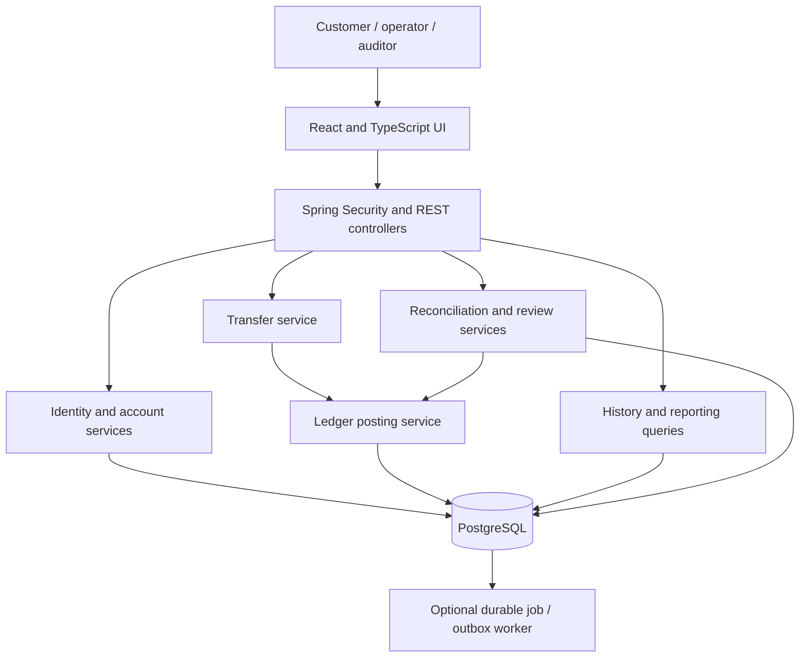

# Digital Banking Ledger & Transaction Reconciliation System

Implementation blueprint — 28 October 2026

Implementation is now present. This document preserves the original plan; see README.md, docs/VERIFICATION.md, and docs/decisions/001-implementation-stack.md for the implemented stack, scope, and checked behavior.

## 1. Project decision and scope

This blueprint follows the banking project named in the request and the existing project folder. The reference to a “Distributed Inventory & Order Management Platform” is treated as an accidental title mismatch.

Build a simulated banking application in which customers can open demo accounts, transfer simulated INR between accounts, and inspect balances and transaction histories. Operations staff import simulated statements, investigate mismatches, and request corrections. Auditors inspect the ledger and audit history.

The engineering focus is correctness: money must not disappear, appear without a balanced entry, be spent twice, or move again because a browser retries a request.

All money and identities are synthetic. This is an educational system, not a real bank, payment processor, regulatory compliance product, or production financial service. It has no real bank connection, UPI, card processing, KYC vendor, paid API, AI service, or cloud dependency.

### Release boundaries

- **First working slice:** sign in, view two demo accounts, post a balanced transfer, and inspect the resulting history.
- **Core release:** authorization, accounts, ledger, balances, ACID transfers, idempotency, concurrent spending protection, history, and basic audit records.
- **Complete portfolio release:** React workflows, internal reconciliation, simulated statement reconciliation, controlled full reversals, staff review, tests, repeatable setup, and documentation.
- **Advanced extension:** durable background jobs, transactional outbox, two application instances sharing PostgreSQL, failure recovery, and measured performance.

The complete portfolio release is a useful finished project. Distributed extensions are a later learning milestone.

## 2. Stack and zero-budget operating model

These are design choices, not a claim that one stack is perfect for every banking system. Freeze exact compatible dependency versions during Phase 0 and record them in the repository.

| Area | Choice | Purpose |
| --- | --- | --- |
| Java | OpenJDK 21, for example Eclipse Temurin | A conservative Java baseline |
| Backend | Stable Spring Boot 4.1.x, Spring MVC | REST application and dependency management |
| Security | Spring Security; server-side sessions | Authentication, role checks, CSRF protection |
| Persistence | Spring Data JPA/Hibernate; explicit locking queries | Entity persistence and controlled account writes |
| Database | PostgreSQL 18 | Transactions, row locks, constraints, reliable relational storage |
| Migrations | Flyway Community functionality | Versioned schema changes; verify PostgreSQL module compatibility |
| Money | Java BigDecimal; PostgreSQL NUMERIC(19,2) | Exact two-decimal INR values |
| Build | Maven Wrapper | Repeatable backend builds |
| Frontend | React 19, TypeScript, Vite | Browser interface |
| Node | Node.js 24 LTS with npm lockfile | Frontend tooling |
| Frontend helpers | React Router, TanStack Query, React Hook Form, Zod | Navigation, server state, form validation |
| Styling | Plain CSS with reusable components | Responsive UI without a paid component kit |
| Backend testing | Spring Boot test starter, managed JUnit, AssertJ, MockMvc | Domain, API, and security checks |
| Database testing | Real isolated PostgreSQL database; Testcontainers when runtime is available | Verify actual locking and rollback behavior |
| Browser testing | Vitest, Testing Library, Playwright | Component behavior and end-to-end workflows |
| Operations | Spring Boot Actuator, structured logs; optional local Prometheus/Grafana | Health, metrics, diagnosis |
| API contract | Version-controlled OpenAPI YAML | Reviewable request and response definitions |
| Tools | Git, VS Code or another free Java IDE, PostgreSQL CLI or DBeaver Community | Development and inspection |

Spring Boot's documented Java range includes Java 21. Let its dependency management select compatible Spring modules instead of overriding them individually. [Spring Boot requirements](https://docs.spring.io/spring-boot/system-requirements.html)

React documents Vite's React/TypeScript starter as a from-scratch option. This application has a separate Java backend and does not require server-side React rendering. [React setup](https://react.dev/learn/build-a-react-app-from-scratch), [Vite guide](https://vite.dev/guide/)

Node 24 is listed as LTS in the checked release table. Confirm the selected Vite release's engine requirements when generating the frontend. [Node releases](https://nodejs.org/en/about/previous-releases)

### What “zero budget” means here

Run the complete application on an existing computer, using its local database and disk. Initial tool and dependency downloads require internet; normal app workflows should subsequently work without external service calls. Electricity, existing hardware, disk space, and internet access are assumed available.

Start with native PostgreSQL, Java, and Node installations. Containers are optional. Podman is a possible local container option; Windows setup uses a virtualized environment and must be checked on the actual computer. [Podman installation](https://podman.io/docs/installation)

Testcontainers needs a Docker-compatible runtime; alternative runtimes may need additional configuration. Do not make successful Windows/Podman integration an assumption. Maintain a real-PostgreSQL test profile as a fallback. Never replace concurrency tests with H2 or SQLite. [Testcontainers runtime requirements](https://java.testcontainers.org/supported_docker_environment/)

Use no managed database, SMS, email delivery, payment gateway, cloud storage, commercial authentication provider, or required hosted CI. Optional hosted tools are only conveniences; free quotas and policies must be checked before adoption. No card or billing account is required by the project design.

As a planning estimate, 8 GB RAM may be workable with native processes; 16 GB gives more room for the IDE, browser, database, and containers. Confirm feasibility on the available computer rather than promising performance.

## 3. Architecture

Start with a modular monolith: one backend executable with clear business modules and one PostgreSQL database. All financial writes stay in that database transaction.



In development, Vite proxies `/api` to Spring Boot. For a packaged local release, Spring Boot can serve the built React assets and API from one origin. This simplifies cookie authentication and deployment.

### Module responsibilities

| Module | Owns |
| --- | --- |
| identity | Users, password hashes, roles, sessions |
| accounts | Customer account ownership, account lifecycle, demo identifiers |
| ledger | General-ledger accounts, immutable journals and entries, posting rules |
| transfers | Customer transfer intent, idempotency, coordination, full reversal links |
| reconciliation | Imports, snapshots, matching results, exceptions, resolution history |
| audit | Actor/action records, business reasons, correlation identifiers |
| reporting | Authorized balance, history, and statement queries |
| jobs, later | Durable job claims, retries, outbox events, consumer deduplication |
| shared | Small error, time, and money abstractions; not a generic dumping ground |

Controllers validate request shape and call services. Services enforce ownership and business rules. Repositories handle persistence. Only the ledger posting service coordinates monetary writes; reconciliation and admin controllers cannot directly edit a balance.

Do not introduce Kafka, Redis, Kubernetes, an API gateway, service discovery, or distributed transactions in the initial release. They add operational work without improving the first learning objective.

## 4. Users, features, and permissions

### Customer

- Register a demo identity and sign in/out.
- Open an INR demo account and view only owned accounts.
- Request an internal transfer to a known demo account identifier.
- View balances, paginated history, transfer details, and downloadable CSV statements.
- Retry an uncertain transfer using the same idempotency key.

Registration always creates a customer role. It never accepts a role supplied by the browser. Public account identifiers are opaque demo identifiers, not real bank or IFSC numbers. Avoid exposing a searchable customer directory.

### Operator

- Review account and transfer details permitted by the staff policy.
- Freeze/unfreeze accounts with a required reason.
- Import synthetic CSV statements and run reconciliation.
- Investigate exceptions and request a full reversal when justified.

### Approver

- Approve or reject a correction request made by a different staff user.
- Approval invokes the same ledger rules; it does not bypass funds checks or create a generic balance-edit endpoint.

### Auditor

- Read authorized journal, reconciliation, and audit records.
- Export investigation evidence.
- Cannot initiate transfers, change account state, or approve corrections.

### System administration

Create staff identities through a documented local provisioning command/profile. Keep technical provisioning separate from financial approval rights. Demo funding is available only in a local demo profile and must itself post a balanced journal.

## 5. Financial model and invariants

### Use double-entry bookkeeping

Every posted monetary event has a journal header and at least two positive entries. Each entry is either DEBIT or CREDIT. For every journal and currency:

```text
sum(debit amounts) = sum(credit amounts)
```

Use the bank's accounting perspective consistently. A customer's deposit is a liability of the simulated bank and has a credit-normal balance.

Example: Alice has INR 5,000 and Bob has INR 1,000. Alice transfers INR 500 to Bob.

| Ledger account | Side | Amount | Customer effect |
| --- | --- | --- | --- |
| Alice deposit liability | DEBIT | 500.00 | Balance decreases to 4,500.00 |
| Bob deposit liability | CREDIT | 500.00 | Balance increases to 1,500.00 |

For local demo funding of INR 5,000: debit a simulated cash asset and credit Alice's deposit liability. Never seed a customer balance by directly updating a number.

### Required invariants

1. A journal balances before its database transaction commits.
2. Posted journal headers and entries cannot be updated or deleted by the application role.
3. Stored balances equal totals recomputed from posted entries using each ledger account's normal side.
4. Customer balances stay nonnegative; v1 has no overdraft, holds, or pending funds.
5. Source and destination are different, active customer accounts in INR.
6. The source account belongs to the authenticated customer for a normal customer transfer.
7. A transfer, its journal, balance changes, terminal idempotency result, and success audit event commit together.
8. One idempotent operation produces at most one committed monetary effect.
9. A correction adds a linked reversing journal; original evidence remains available.
10. All financial writes, account freezes, and reversals follow the same account locking convention.

### Money, time, and database enforcement

- Parse amounts from decimal strings; reject zero, negative values, excessive size, and more than two decimal places before persistence. Do not silently round user transfers.
- Use `BigDecimal` constructed from strings, and numeric comparison rather than scale-sensitive equality.
- Use `NUMERIC(19,2)` with sensible application maximums. Reject non-finite numeric values at the database boundary as well as in validation.
- Send monetary API values as strings, such as `"500.00"`; the browser formats them without using binary floating-point arithmetic for financial decisions.
- Store instants in UTC with `TIMESTAMPTZ`; show the display timezone explicitly. Statement ranges use an inclusive start and exclusive end.
- Add foreign keys, positive-amount checks, enum/check constraints, unique references, and ownership indexes.
- Enforce cross-entry journal balance with a tested deferred database constraint trigger at commit, covering headers and entries so an empty journal cannot slip through. A row-level CHECK cannot sum other rows.
- Use an application database role without journal UPDATE/DELETE privileges and protective triggers. Migration ownership is separate.
- The journal is authoritative; the stored balance is a transactionally maintained projection used for fast reads and funds checks. Reconciliation checks that projection independently.

PostgreSQL distinguishes exact numeric values from inexact floating-point types. [PostgreSQL numeric types](https://www.postgresql.org/docs/current/datatype-numeric.html)

Append-only controls protect against application mistakes and ordinary application credentials. They are not proof against a database owner or machine administrator altering data.

## 6. Proposed database design

| Table | Main fields and rules |
| --- | --- |
| users | id, normalized unique email, password_hash, enabled, created_at |
| roles / user_roles | Controlled role assignments; no browser-supplied staff roles |
| bank_accounts | id, owner_user_id, unique public_account_ref, unique ledger_account_id |
| ledger_accounts | id, account_type, normal_side, INR currency, ACTIVE/FROZEN/CLOSED status |
| account_balances | unique ledger_account_id, balance, updated_at; created with account |
| journals | id, unique reference, event_type, currency, posted_at, unique nullable reversal_of_journal_id |
| ledger_entries | id, journal_id, ledger_account_id, DEBIT/CREDIT side, positive amount |
| transfers | id, initiating_user_id, source, destination, amount, journal_id, created_at |
| idempotency_requests | user_id, operation, key, request_hash, terminal HTTP status/body, transfer_id; composite uniqueness |
| audit_events | id, actor, action, target, outcome, reason, correlation_id, occurred_at |
| statement_imports | id, source, file_hash, parser_version, interval, status, uploader |
| statement_rows | import_id, source_line_number, external_reference, account_ref, signed_amount, currency, booking_time, validation outcome |
| reconciliation_runs | id, import_id, algorithm_version, interval, snapshot time, lifecycle state, counts |
| reconciliation_snapshot_items | run_id, internal entry/reference/account/amount values used in this run |
| reconciliation_exceptions | run_id, category, evidence links, state, assigned operator |
| exception_events | append-only comments, decisions, and status transitions |
| correction_requests | original journal, reason, requester, approver, decision, resulting reversal |
| outbox_events, later | unique event_id, aggregate_id, payload, retry state, next_attempt_at |
| processed_events, later | consumer_id + event_id uniqueness for deduplication |
| jobs, later | job type, state, attempt count, lease/claim data, next_attempt_at |

For single-instance v1, default server sessions may be in memory. In the two-instance extension, use Spring Session JDBC with PostgreSQL so authentication is shared.

Add indexes for account history `(ledger_account_id, posted_at, id)`, account ownership, reconciliation references, open exception lookup, and idempotency uniqueness. Refine using query plans rather than indexing every column.

History should be derived from ledger entries joined to journals, with transfer metadata for the display. Do not maintain a separate editable financial history table.

## 7. Transfer processing, locking, and retries

### Request contract

```http
POST /api/v1/transfers
Idempotency-Key: client-generated-uuid
Content-Type: application/json
X-CSRF-TOKEN: token-obtained-through-security-flow
```

```json
{
  "sourceAccountId": "source-account-uuid",
  "destinationAccountRef": "DEMO-recipient-reference",
  "amount": "500.00",
  "currency": "INR",
  "description": "Shared expense"
}
```

The server derives the initiating user from the authenticated session. Amount, ownership, currency, destination validity, and funds are checked by the server.

### Atomic posting algorithm

1. Authenticate, verify request shape, and establish the caller's authority. Apply ownership checks before returning any saved result.
2. Normalize the transfer intent and compute its request hash. Include all fields that define the operation, including account references, amount, currency, and description under a documented normalization rule.
3. Enter a public transactional service method through Spring's proxy. Use one database transaction for the financial operation.
4. Reserve `(user, operation, idempotency_key)` using a PostgreSQL conflict-safe insert. A plain check-then-insert is insufficient under concurrency. Do not catch a uniqueness exception and keep using an aborted transaction.
5. If a committed request already exists, compare hashes: replay the saved terminal result when equal; return `409 IDEMPOTENCY_KEY_REUSED` when different. An in-flight conflicting insert may wait for commit; apply a bounded timeout.
6. Resolve both ledger account IDs. Lock their ledger-account rows one at a time in ascending immutable ID order using `FOR UPDATE` or a tested JPA pessimistic write lock.
7. After locking, read current account states and balance rows. All balance writers and freeze commands acquire these parent account locks first. Reject inactive accounts and insufficient funds.
8. Insert the transfer, journal header, and debit/credit entries. Update both balance projections under the locks.
9. Insert the success audit event and persist the terminal idempotency response. Later, insert an outbox event here as well.
10. Flush so constraint failures are surfaced, commit, and only then return success to the browser.

Use PostgreSQL READ COMMITTED plus explicit account locks as the initial transfer strategy. Keep transactions short: no network calls, file parsing, or waiting for human approval inside them. Spring Data supports repository lock metadata, and PostgreSQL documents row-lock behavior and consistent lock ordering. [Spring Data locking](https://docs.spring.io/spring-data/jpa/reference/jpa/locking.html), [PostgreSQL locking](https://www.postgresql.org/docs/current/explicit-locking.html)

Spring's default proxy-based transactions do not apply to self-invocation. Put the transactional boundary in a separately called service and explicitly test rollback. Review checked-exception rollback configuration instead of assuming every exception rolls back. [Spring transaction annotations](https://docs.spring.io/spring-framework/reference/data-access/transaction/declarative/annotations.html)

### Distinguish rejection from technical uncertainty

- **Expected business rejection:** for example, insufficient funds. Commit a saved rejection result and corresponding audit record without financial changes. A replay with the same key returns that same rejection; a new intentional attempt uses a new key.
- **Unexpected failure before commit:** roll back the entire financial transaction. Record diagnostic failure information outside the rolled-back transaction if needed, without claiming a successful transfer.
- **Response lost after commit:** retry the exact intent with the same key and replay the saved success.
- **Lock timeout or deadlock:** abort and retry the whole transaction in a new transaction with bounded attempts and jitter, or return a retryable response. Never retry only the second balance update.
- **Unknown status:** keep the same key. A lookup returning no committed result does not prove an in-flight request will fail.

Keep financial idempotency records for the v1 dataset lifetime. Do not expire a key after a few minutes and accidentally permit a duplicate debit. Promise at most one committed effect for the defined request scope, not universal “exactly once” execution.

## 8. Reconciliation design

Reconciliation asks whether independently represented financial records agree. It is not a dashboard that merely compares two sums from the same table.

### A. Internal integrity reconciliation

Within a consistent database snapshot:

- Verify every journal balances per currency and has its required entries.
- Recompute each account balance from immutable entries and compare it with the stored projection.
- Check that posted transfers have the expected journal and account legs.
- Detect orphaned references, invalid reversal relationships, and impossible customer balances.

Persist the run parameters, algorithm version, evidence, and findings. Do not directly change a balance to hide a mismatch.

### B. Simulated external statement reconciliation

Use an explicitly labelled synthetic statement source. Begin with hand-authored golden fixtures and a small independent statement simulator driven by an expected-event manifest. Do not generate the only “external” truth by reading back the application's ledger.

Example CSV fields:

```text
external_reference,account_ref,booking_time,signed_amount,currency
DEMO-T001,DEMO-ALICE,2026-10-28T09:30:00Z,-500.00,INR
DEMO-T001,DEMO-BOB,2026-10-28T09:30:00Z,500.00,INR
```

The signs are from the customer's statement perspective: outgoing is negative, incoming positive. Each transfer has two customer legs. Matching uses `(reference, account_ref)` followed by direction, currency, and exact amount. Timestamp is supporting evidence, not the sole matching key. Reversals have distinct references linked to originals.

Initial exception categories:

- Missing statement leg.
- Statement row with no internal posting.
- Amount mismatch.
- Currency or direction mismatch.
- Duplicate statement reference/account leg.
- Ambiguous candidate match.
- Malformed row or unknown account reference.

### Import and run workflow

1. Accept only bounded-size CSV uploads under a documented schema; never accept user-chosen server file paths.
2. Preserve the original file or its verified contents and hash, parser version, source, and line numbers. Store originals locally outside public web assets.
3. Stage and validate all rows. Preserve invalid-row evidence and prevent invalid batches from silently being reported as fully matched.
4. Detect exact repeat uploads using source and content hash; retain duplicate rows as exceptions rather than silently discarding them.
5. Materialize the selected internal records for a reconciliation run in a consistent snapshot and persist those items for reproducibility.
6. Match deterministically, save evidence, expose counts, and create exceptions.
7. Allow a reviewed rerun as a new versioned run; never overwrite the previous run's findings.

Record the exact statement interval and the internal snapshot capture time. A timestamp or highest sequence ID alone is not a commit-order watermark. First demonstrate external reconciliation on a finalized demo fixture batch; the advanced worker phase can add sealed export batches and a documented late-arrival policy. Late entries should be explained and checked in a subsequent run, not automatically labelled missing because of a race.

When exporting CSV, neutralize spreadsheet formula prefixes in text cells. Reconciliation failures must not block normal transfer commits.

### Exception handling and full reversals

Suggested exception lifecycle: OPEN → INVESTIGATING → AWAITING_APPROVAL → RESOLVED or DISMISSED. Record who changed it and why; preserve each transition.

A different staff user approves a requested financial correction. Approval locks and revalidates the request before posting. A full reversal swaps the original debit/credit sides in a new journal and has a database-enforced unique link to the original, preventing two full reversals even with different request keys.

If the receiving customer has already spent the funds, the reversal must not make their balance negative. Leave the request unresolved for review. Likewise, frozen accounts require the documented account-state workflow. Approval does not bypass financial invariants. Partial reversals, chargebacks, suspense allocations, and automatic write-offs are outside v1.

## 9. REST API outline

| Group | Endpoints | Main rule |
| --- | --- | --- |
| Security | GET `/api/v1/auth/csrf`; POST `/auth/register`, `/auth/login`, `/auth/logout`; GET `/auth/me` | Prefix all under `/api/v1`; protect state changes |
| Accounts | POST `/api/v1/accounts`; GET `/accounts`; GET `/accounts/{id}` | Customer ownership |
| Balances | GET `/api/v1/accounts/{id}/balance` | Return currency and decimal strings |
| Transfers | POST `/api/v1/transfers`; GET `/transfers/{id}` | Required key on POST; authorized participants/staff on GET |
| Request status | GET `/api/v1/transfer-requests/{idempotencyKey}` | Only the caller's transfer-operation scope |
| History | GET `/api/v1/accounts/{id}/transactions` | Bounded pagination, stable order, date filters |
| Statements | GET `/api/v1/accounts/{id}/statement.csv` | Ownership and bounded interval |
| Account operations | POST `/api/v1/ops/accounts/{id}/freeze`, `/unfreeze` | Staff policy, reason, shared lock convention |
| Reconciliation | POST `/api/v1/ops/statement-imports`; POST `/ops/reconciliation-runs`; GET run/results | Authorized operations roles |
| Exceptions | GET `/api/v1/ops/reconciliation-exceptions`; POST `/{id}/events` | Explicit allowed transitions |
| Corrections | POST `/api/v1/ops/correction-requests`; POST `/{id}/approve`, `/{id}/reject` | Different maker and approver |
| Audit | GET `/api/v1/audit/events`; GET `/audit/journals/{id}` | Read-only audit permission |
| Health | GET `/actuator/health` | Minimal public detail; metrics restricted |

Every abbreviated endpoint in a group uses the same stated group prefix. Publish the complete expanded paths in OpenAPI during implementation.

Use DTOs rather than exposing persistence entities. Define a common problem response with code, safe message, correlation ID, and field errors. Examples: `INVALID_AMOUNT`, `INSUFFICIENT_FUNDS`, `ACCOUNT_NOT_ACTIVE`, `IDEMPOTENCY_KEY_REUSED`, `TRANSFER_RETRYABLE`, and `APPROVAL_NOT_ALLOWED`.

Use `201` for a newly posted transfer, `400` for malformed requests, `401/403` for authentication/authorization, `409` for state/key conflicts, `422` for a documented business rejection, and `503` for a transient database availability/locking outcome. Decide whether unauthorized object access uses 403 or a non-disclosing 404 and apply it consistently.

## 10. Authentication, audit, and safe administration

Use Spring Security server-side sessions for the browser. They provide straightforward logout and avoid introducing token signing and refresh-token storage before they are needed.

- Hash passwords with a supported adaptive password encoder such as BCrypt; never log credentials.
- Use HttpOnly session cookies, SameSite policy, session rotation on login, expiry, and Secure cookies in HTTPS configurations. Any HTTP-localhost exception must be confined to the local development profile.
- Keep CSRF protection enabled. Implement the documented SPA token flow, including token refresh after login/logout. The CSRF token may be readable by the client; the session cookie must remain HttpOnly.
- Apply explicit-origin rules if cross-origin access is needed. Prefer the same-origin setup described earlier.
- Enforce object ownership and staff permissions in backend services; hidden React buttons are not access controls.
- Restrict login attempts and bound request body, CSV size, page size, query intervals, and execution time.
- Never log full session tokens or passwords; use synthetic identifiers and avoid unnecessary personal data.
- Keep database credentials in local environment configuration; commit only examples. Use separate development and test databases.

Spring Security enables CSRF protection for unsafe methods and documents extra considerations for single-page applications. [Spring Security CSRF](https://docs.spring.io/spring-security/reference/servlet/exploits/csrf.html)

Audit financial success in the same transaction as the financial state change. Expected business rejections can persist audit records without monetary changes. Authentication and unexpected technical failure events need a separate recording path because their surrounding transaction may fail.

Audit records should include actor, action, object, outcome, reason, timestamp, and request correlation. Journal entries explain money movement; audit events explain who performed an action. They are different records with different purposes.

## 11. React experience

### Customer screens

1. Login and registration with plain validation feedback.
2. Dashboard with owned accounts and INR balances.
3. Transfer form with destination, amount, optional description, and review step.
4. Transfer result/detail with reference, status, and retry guidance.
5. Account history with date filters, stable pagination, and CSV export.

### Staff screens

1. Operations overview with run and exception counts.
2. Statement upload with schema guidance and row validation results.
3. Reconciliation run detail with matched/missing/duplicate/mismatch views.
4. Exception evidence, comments, and correction requests.
5. Approval queue that prevents self-approval.
6. Read-only audit and journal explorer.

Support mobile-width layouts, keyboard navigation, labels, visible focus, loading states, empty states, session expiry, and useful errors. The transfer UI generates one idempotency key per confirmed intent and retains it through retries. Disabling the submit button improves usability but is not the duplicate-posting safeguard.

Show an uncertain network outcome as “checking transfer status,” not “failed” with an immediate new payment button. A changed amount or recipient creates a new intent and key.

## 12. Development phases and completion gates

The estimates below are planning ranges for focused work, not delivery promises. A beginner may need additional time for Java, SQL, HTTP, and React practice. At roughly 10–15 hours per week, plan about 3–5 months for the complete portfolio release, with the distributed extension adding time.

### Phase 0 — Foundation and tool verification (2–4 sessions)

Learn/review Java classes, interfaces, exceptions, collections, BigDecimal, basic SQL, Git, HTTP methods, JSON, and the difference between authentication and authorization.

Inspect installed Java, Maven access, Node/npm, PostgreSQL, Git, memory, and optional container capability. Choose compatible stable dependencies, freeze versions, and create the architecture and money-policy decisions. Use local tools first.

**Gate:** Java and Node build a small sample; Java can connect to a dedicated PostgreSQL database; setup instructions are reproducible. No financial implementation yet.

### Phase 1 — Repository and vertical skeleton (3–5 sessions)

Generate Spring Boot with Web MVC, Security, Validation, Data JPA, PostgreSQL driver, Flyway, Actuator, and test dependencies. Generate React/TypeScript with Vite. Add Maven Wrapper, npm lockfile, environment examples, profiles, initial migration, consistent errors, and a frontend API client.

**Gate:** React displays a backend response; migration works against a fresh database; backend and frontend build; no secret is committed.

### Phase 2 — Identity and accounts (4–6 sessions)

Implement registration, login/logout, CSRF flow, role provisioning, ownership checks, zero-balance account creation, and account views. Introduce tests alongside these features.

**Gate:** Two different customers cannot access each other's accounts; a customer cannot grant themselves staff rights; account state survives restart.

### Phase 3 — Ledger and balanced demo funding (5–8 sessions)

Implement chart-of-account types, immutable journal/entry schema, normal-side balance arithmetic, posting service, projection updates, account locks, and balanced demo funding. Add commit-time journal validation and restricted application credentials.

**Gate:** A known fixture has correct customer balances; all journals balance; an unbalanced/empty journal fails at commit; editing posted evidence is denied to the application role.

### Phase 4 — Transfer correctness (6–10 sessions)

Implement atomic transfers, key reservation/replay, normalized request hashes, deterministic account locking, account-state checks, rejection records, whole-transaction retry policy, and request-status lookup.

**Gate:** Parallel transfers cannot overspend; duplicate keys cannot move money twice; an injected failure after the first financial write leaves no partial movement; a lost response can be recovered safely.

This completes the core backend release.

### Phase 5 — Customer UI and histories (4–7 sessions)

Build dashboards, transfer confirmation, uncertain-result recovery, transaction details, filtered history, statement export, and responsive layouts. Use ledger-derived history and exact decimal strings.

**Gate:** A browser walkthrough covers login → transfer → result → both account histories → replay → logout; unauthorized and expired-session paths behave correctly.

### Phase 6 — Reconciliation engine (6–10 sessions)

Build internal integrity checks, staged CSV imports, independent golden statement fixtures, consistent internal snapshots, deterministic matching, exception generation, and versioned reruns.

**Gate:** Each known anomaly fixture produces exactly the expected findings. Repeated imports do not create financial postings. A clean finalized fixture batch matches completely.

### Phase 7 — Staff review, reversals, and audit (4–7 sessions)

Implement staff screens, exception history, maker/approver separation, controlled full reversals, audit search, and protected evidence export.

**Gate:** Self-approval fails; simultaneous approvals cannot reverse twice; spent recipient funds block reversal; the original journal remains unchanged; every decision has an actor and reason.

This completes the intended feature scope.

### Phase 8 — Reliability and release preparation (5–8 sessions)

Consolidate automated regression checks, inspect query plans, add measured load scenarios, validate local backup/restore, package React with Spring Boot, document clean setup, and prepare an evidence-based demo.

**Gate:** A clean checkout builds; all required tests pass on real PostgreSQL; backup restoration reproduces balances and journal totals; known limitations and measured test environment are documented.

This is the complete portfolio release.

### Phase 9 — Distributed processing extension (6–12 sessions)

Add PostgreSQL-backed durable jobs, outbox records in the posting transaction, a retrying worker, consumer deduplication, Spring Session JDBC, and two backend instances sharing the database. Run behind a local reverse proxy only when needed for this demonstration.

**Gate:** Two app instances still prevent duplicate/overspending transfers; jobs recover after process restarts; killing the worker after delivery but before acknowledgement produces no duplicate consumer effect. No cross-service money movement is needed.

### Phase 10 — Optional specialization

Choose one extension: pending funds and holds; scheduled transfers; multi-currency with explicit FX accounting; local broker delivery; or a separately deployed read-only reporting service.

Each needs a new domain design and tests. Do not add all of them to make the stack longer. A real cross-database transfer system is a separate project-level problem involving settlement and failure semantics.

## 13. Tests that prove the design

Write tests with each phase. The later reliability phase verifies the integrated release; it is not the first time testing begins.

| Scenario | Evidence required |
| --- | --- |
| Transfer INR 500 from balances 5,000 and 1,000 | Final balances 4,500 and 1,500; one balanced journal |
| Transfer above available balance | Saved business rejection; no financial entries or balance changes |
| Twenty concurrent debits of INR 100 from INR 1,000 | Ten succeed if no other activity; ten reject; ending source balance zero |
| Fifty simultaneous copies of one request/key | One transfer and journal; same terminal result after any retryable waits |
| Same key, different amount or recipient | Conflict; no second financial effect |
| Failure after the first financial write | Whole transaction rolls back |
| Database commit succeeds but response is dropped | Same-key retry returns original transfer |
| Opposite-direction transfers | Correct totals; no partial postings; retry handling is bounded |
| Freeze racing a transfer | Outcome follows shared account locks and a consistent state policy |
| Cross-user account and transfer access | Denied without leaking private records |
| Missing/invalid CSRF token | State-changing request rejected |
| Direct insert of invalid/empty journal | Database rejects it at commit |
| Direct edit/delete of journal as app role | Denied |
| Stored balance corrupted in isolated test fixture | Internal reconciliation detects exact discrepancy |
| Synthetic missing, duplicate, amount, currency, and direction errors | Expected per-leg reconciliation categories and evidence |
| Duplicate upload or rerun | No monetary change; deduplication/versioning follows policy |
| Two approvals for one reversal | Only one reversing journal |
| Reversal after recipient spent the money | Refused; no negative balance |
| Database backup and restore | Balances, entries, and audit links remain consistent |
| Worker crash after event delivery, later | Duplicate delivery does not duplicate consumer effects |

Use separate connections and real committed transactions for concurrency tests. Coordinate starts with barriers/latches rather than arbitrary sleeps. Tests that always roll back their enclosing test transaction cannot prove commit-time constraints; explicitly commit or use TransactionTemplate where necessary.

Add randomized transfer sequences and assert invariant preservation after each sequence. Keep a fixed random seed when diagnosing failures.

For load testing, start with a modest dataset and concurrency level appropriate to the computer. Measure throughput, p50/p95 latency, errors, lock waits, and final invariants separately. Report actual hardware and dataset. Do not promise a transactions-per-second number before measuring it.

## 14. Advanced worker and event design

The first advanced use case should be generating reports or handling reconciliation jobs, not moving a debit and credit into different services.

Write an outbox event in the same transaction as the transfer. The worker claims a bounded batch, processes it, and records progress durably. Multiple workers may use `FOR UPDATE SKIP LOCKED` for queue rows; this is not the account-locking strategy.

Assume at-least-once delivery. Assign every event an immutable ID; use `(consumer_id, event_id)` uniqueness and commit the consumer's database changes with its processed marker. A crash between delivery and acknowledgement must be safe to replay.

Maintain attempts, next-attempt time, last error, and a failed/dead-letter state. Preserve per-account event ordering when a consumer actually requires it; a notification consumer may not. Keep the ledger authoritative regardless of worker availability.

A broker is optional. A PostgreSQL worker is enough to demonstrate atomic event creation, retry behavior, durable state, and deduplication with no additional service dependency.

## 15. Repository and local workflow

```text
project-root/
  README.md
  backend/
    pom.xml
    mvnw, mvnw.cmd
    src/main/java/.../
      identity/
      accounts/
      ledger/
      transfers/
      reconciliation/
      audit/
      reporting/
      shared/
    src/main/resources/
      application.yml
      db/migration/
    src/test/
  frontend/
    package.json
    package-lock.json
    src/
      app/
      features/auth/
      features/accounts/
      features/transfers/
      features/reconciliation/
      features/audit/
      components/
      api/
  docs/
    IMPLEMENTATION_BLUEPRINT.md
    architecture.md
    accounting-rules.md
    openapi.yaml
    testing.md
    operations.md
    limitations.md
    decisions/
  fixtures/
    statements/
    expected-results/
  scripts/
    dev.ps1
    verify.ps1
    backup.ps1
    restore-test.ps1
  infra/                       # optional local container configuration
  .env.example
  .gitignore
```

The tree is the planned structure, not a claim these files already exist.

Use Flyway migrations, `ddl-auto=validate`, and separate dev/test/demo profiles. Never use automatic schema recreation for a persistent demo database. Keep uploads, database dumps, credentials, dependency caches, and generated logs out of Git.

On Windows, quote the existing project path because it contains an ampersand. When creating scripts, use literal paths for file operations. There is no need to rename the user's folder.

Once scaffolded, the usual workflow will be:

```powershell
# Run from the backend directory
.\mvnw.cmd verify
.\mvnw.cmd spring-boot:run

# Run from the frontend directory in a separate terminal
npm ci
npm run dev
npm run build
```

Database connection details and profile selection will be documented during setup. Local scripts should start required processes with clear health checks and must not silently destroy a database. Resetting demo data needs a dedicated, clearly named command targeting only the demo database.

## 16. Demo, documentation, and release criteria

Prepare a repeatable demonstration:

1. Create Alice and Bob with balanced demo funding.
2. Transfer INR 500 and show both histories plus the journal.
3. Replay the same request and show no second debit.
4. Run the concurrent spending scenario and verify conservation.
5. Import a synthetic statement containing a missing leg, a duplicate, and an amount mismatch.
6. Show findings and their source-line/internal-entry evidence.
7. Request and approve one full reversal with different staff users.
8. Show the original journal, reversing journal, and audit trail.
9. Run a clean integrity reconciliation after the demonstration.

The README should contain the project purpose, architecture diagram, setup, exact tested versions, screenshots, accounting example, API examples, test commands, measured evidence, and limitations. Include design decisions explaining the monolith, session authentication, row locks, decimal money, idempotency, and independent reconciliation fixtures.

Before release, require passing backend tests, real-database concurrency tests, frontend checks/build, browser workflows, clean-database migration, and backup/restore verification. List checks that could not be performed instead of implying they passed.

Accurate portfolio description after implementation: “Built a simulated banking ledger with atomic internal transfers, idempotent REST operations, PostgreSQL row locking, and reconciliation against synthetic statement data.” Add counts, timings, or concurrency numbers only after measuring them.

Do not describe the project as a licensed bank, real payment integration, regulatory-compliant product, high-availability service, or production-proven financial platform.

## 17. Starting point for the next implementation step

Begin with Phase 0 and Phase 1: verify the computer's installed tools, freeze compatible versions, scaffold backend/frontend, connect PostgreSQL, and run the first migration and browser-to-backend request.

Do not start with staff dashboards, brokers, or microservices. The first financial milestone is a small, tested ledger that posts balanced demo funding and one transfer correctly.

At the original planning step only this blueprint existed. The subsequent implementation is documented in README.md and docs/VERIFICATION.md. Repository publication and public deployment are separate from this local build.
